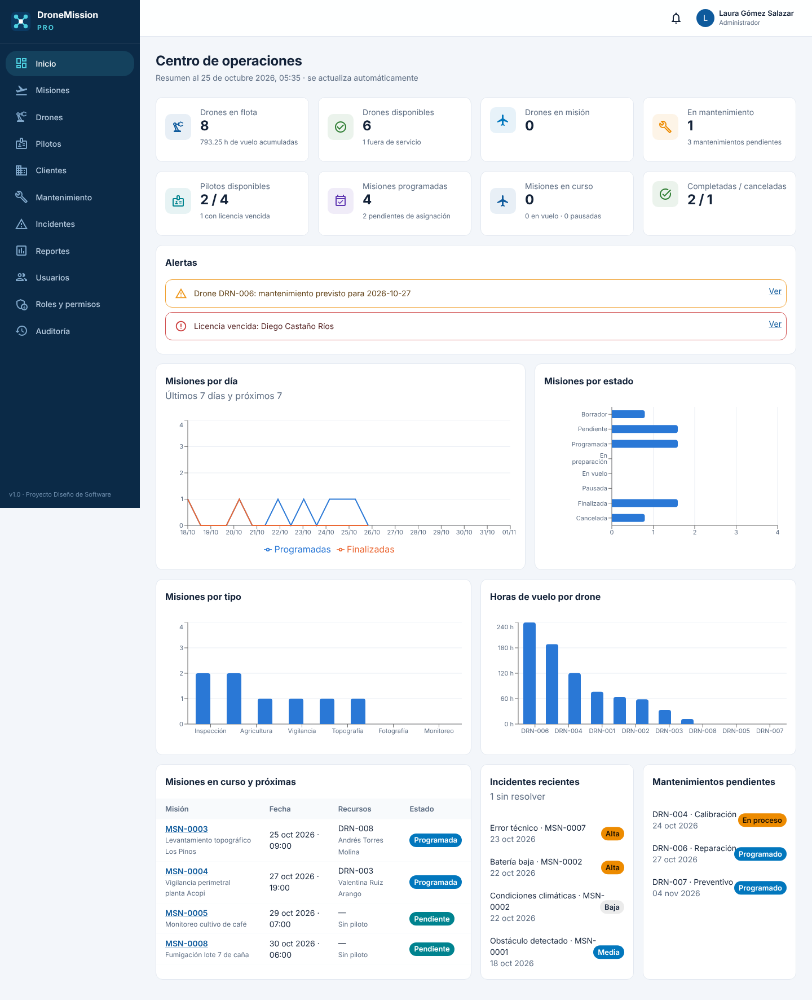

# DroneMission Pro

**Sistema de gestión de operaciones y misiones con drones.** Proyecto de la materia *Diseño de Software*: frontend React + TypeScript, backend Spring Boot, base de datos relacional, seguridad JWT con roles, drone virtual con telemetría simulada, reportes PDF, pruebas, diagramas UML y documentación completa.

**🌐 En línea:** https://dronemission-pro.onrender.com — inicia sesión con tu cuenta o pulsa **Crear cuenta** (un administrador debe aprobarla). La primera visita puede tardar ~1 minuto en despertar el servidor.



---

## 1. Descripción

DroneMission Pro centraliza la operación de una empresa que presta servicios con drones (inspección, agricultura, vigilancia, topografía, fotografía y monitoreo): registra drones, pilotos y clientes; planifica misiones; asigna recursos validando reglas de negocio; sigue el vuelo en tiempo real; registra incidentes, evidencias y mantenimientos, y genera reportes.

> **Drone virtual.** No se necesita un drone físico. Cada misión tiene un **plan de vuelo programado** (puntos de ruta generados según el tipo de misión). Cuando el piloto despega, un **simulador** recorre ese plan y envía telemetría (posición, altitud, velocidad, batería, distancia, temperatura y tiempo) **claramente marcada como datos de demostración**.

## 2. Objetivo

Diseñar y desarrollar un sistema que permita administrar de forma organizada, segura y eficiente las misiones con drones, con trazabilidad completa. Ver [análisis](docs/requirements/analisis.md).

## 3. Funcionalidades

- Login con correo **o** nombre de usuario (JWT), **registro público con aprobación del administrador**, contraseñas seguras, bloqueo por intentos fallidos y 5 roles con permisos configurables.
- Dashboard con indicadores, gráficas, alertas, incidentes y mantenimientos pendientes.
- CRUD de drones (búsqueda, filtros, historial, batería), pilotos (licencias y certificaciones), clientes y usuarios.
- Misiones con **máquina de estados**: Borrador → Pendiente → Programada → En preparación → En vuelo ⇄ Pausada → Finalizada / Cancelada.
- Asignación de drone y piloto con validaciones (mantenimiento, batería, compatibilidad, licencia, cruces de horario) y motivo visible de los recursos no elegibles.
- Plan de vuelo por tipo de misión (patrón Strategy) y **telemetría simulada en vivo** con mapa, indicadores y gráficas.
- Incidentes (uno crítico pausa el vuelo), alerta automática de batería baja, evidencias con subida de archivos.
- Mantenimiento con cambio automático del estado del drone.
- Reportes en PDF (misión, drones, pilotos, mantenimiento) e historial.
- Auditoría y notificaciones (patrón Observer).

## 4. Arquitectura

```
React + TypeScript (Vite, MUI)  ──HTTPS/JSON + JWT──►  Spring Boot (API REST)
                                                       Controller → Service → Repository
                                                                              │ JPA / Flyway
                                                                   PostgreSQL  o  H2 embebida
```

Documentada con las vistas de **contexto, funcional, lógica, desarrollo y despliegue**: [docs/architecture/arquitectura.md](docs/architecture/arquitectura.md).

## 5. Tecnologías

| Capa | Tecnologías |
|---|---|
| Frontend | React 18, TypeScript, Vite, React Router, Material UI, Recharts, Axios, Day.js |
| Backend | Java 17, Spring Boot 3.3 (Web, Data JPA, Security, Validation), JWT (jjwt), Lombok, OpenPDF, springdoc-openapi |
| Base de datos | H2 (por defecto, sin instalación) o PostgreSQL 16; migraciones Flyway |
| Pruebas | JUnit 5, Mockito, Spring Boot Test + MockMvc, Vitest |
| Diagramas | PlantUML |

## 6. Requisitos

| Programa | Versión | Obligatorio |
|---|---|---|
| Java JDK | 17 o superior ([Temurin](https://adoptium.net)) | Sí |
| Node.js | 18 o superior ([nodejs.org](https://nodejs.org), versión LTS) | Sí |
| PostgreSQL | 14+ | No (se usa H2 por defecto) |
| Docker | — | No |

No hace falta instalar Maven: el proyecto incluye el *Maven Wrapper* (`mvnw`).

## 7. Instalación

```bash
git clone https://github.com/NIckys310/DroneMission-Pro.git
cd DroneMission-Pro
```

## 8. Configuración

Toda la configuración tiene valores por defecto para desarrollo. Para cambiarla, copia `.env.example` como variables de entorno del sistema (o en tu IDE).

## 9. Variables de entorno

| Variable | Por defecto | Descripción |
|---|---|---|
| `SPRING_PROFILES_ACTIVE` | `h2` | `h2` (archivo local) o `postgres` |
| `DB_HOST`, `DB_PORT`, `DB_NAME`, `DB_USER`, `DB_PASSWORD` | localhost, 5432, dronemission, dronemission, dronemission | Conexión PostgreSQL |
| `JWT_SECRET` | clave de desarrollo | Clave de firma JWT (≥ 32 caracteres). **Cámbiala en producción** |
| `JWT_EXPIRATION_MINUTES` | 480 | Duración del token |
| `ADMIN_EMAIL`, `ADMIN_USERNAME`, `ADMIN_FIRST_NAME`, `ADMIN_LAST_NAME`, `ADMIN_PASSWORD` | vacío | Administrador dueño que se crea al arrancar |
| `ADMIN_RESET_PASSWORD` | false | `true` vuelve a poner `ADMIN_PASSWORD` al dueño |
| `APP_DEMO_USERS` | true | `false` desactiva los usuarios demo (nube) |
| `APP_REGISTRATION_ENABLED` | true | Permite crear cuentas desde el login |
| `APP_SHOW_RESET_TOKEN` | true | Muestra el token de recuperación simulado (`false` en la nube) |
| `H2_CONSOLE_ENABLED` | true | Consola web de H2 (`false` en la nube) |
| `APP_MAX_FAILED_ATTEMPTS` / `APP_LOCK_MINUTES` | 5 / 15 | Bloqueo por intentos fallidos |
| `APP_AUTH_REQUESTS_PER_MINUTE` | 20 | Límite de intentos por IP |
| `CORS_ALLOWED_ORIGINS` | http://localhost:5173 | Origen del frontend |
| `STORAGE_PATH` | ./uploads | Carpeta de evidencias |
| `SIMULATION_TICK_MS` / `SIMULATION_TIME_FACTOR` | 2000 / 3 | Frecuencia y aceleración del drone virtual |

## 10. Base de datos

- **Por defecto (H2):** no instalas nada; la base se crea en `backend/data/` al primer arranque. Flyway ejecuta `V1__esquema_inicial.sql` (tablas en español con PK, FK, UNIQUE, CHECK e índices) y `V2__datos_iniciales.sql` (datos demo). Para reiniciarla, borra `backend/data/`.
- **PostgreSQL (opcional):**
  ```sql
  CREATE USER dronemission WITH PASSWORD 'dronemission';
  CREATE DATABASE dronemission OWNER dronemission;
  ```
  y arranca el backend con `SPRING_PROFILES_ACTIVE=postgres`. Las tablas se crean solas.
- Copias del script en [`database/schema.sql`](database/schema.sql) y [`database/seed.sql`](database/seed.sql). Diagrama: [ERD](docs/diagrams/png/erd/erd.png).

## 11. Ejecución del backend

**Windows:** doble clic en `iniciar-backend.bat`. **Linux/Mac:** `./iniciar-backend.sh`.

O manualmente:
```bash
cd backend
mvnw.cmd spring-boot:run        # Windows
./mvnw spring-boot:run          # Linux / Mac
```
La API queda en http://localhost:8080 (Swagger: http://localhost:8080/swagger-ui.html).

Con PostgreSQL (PowerShell): `$env:SPRING_PROFILES_ACTIVE="postgres"; .\mvnw.cmd spring-boot:run`

## 12. Ejecución del frontend

**Windows:** doble clic en `iniciar-frontend.bat`. **Linux/Mac:** `./iniciar-frontend.sh`.

O manualmente:
```bash
cd frontend
npm install      # solo la primera vez
npm run dev
```
Abre **http://localhost:5173**. (Arranca primero el backend.)

## 13. Usuarios y seguridad

### Cuentas
- **Administrador dueño:** se crea al arrancar con las variables secretas `ADMIN_EMAIL`, `ADMIN_USERNAME`, `ADMIN_FIRST_NAME`, `ADMIN_LAST_NAME` y `ADMIN_PASSWORD` (nunca se guardan en el código).
- **Demás personas:** pulsan **Crear cuenta** en el login. La cuenta queda **pendiente**; el administrador la aprueba en *Usuarios* y le asigna su rol (y su ficha de piloto o cliente). Hasta entonces no puede entrar.
- Se puede iniciar sesión con el **correo o el nombre de usuario**.

### Medidas de seguridad
| Medida | Detalle |
|---|---|
| Contraseñas seguras | 8+ caracteres, mayúscula, minúscula, número y sin el nombre/usuario/correo (se valida en el frontend **y** en el backend) |
| Cifrado | BCrypt (costo 12); nunca se guarda la contraseña |
| Fuerza bruta | 5 intentos fallidos ⇒ cuenta bloqueada 15 minutos; máx. 20 intentos por minuto por IP (HTTP 429) |
| Mínimo privilegio | Las cuentas nuevas no tienen permisos hasta ser aprobadas |
| Servidor público | Usuarios demo desactivados, consola H2 apagada, token de recuperación oculto, JWT con clave generada por Render |
| Desbloquear / olvidé mi contraseña | El administrador asigna una nueva contraseña en *Usuarios* (eso también desbloquea). Si el dueño olvida la suya: `ADMIN_RESET_PASSWORD=true` en Render y reiniciar |

### Usuarios demo (solo en tu computadora)
En local (`APP_DEMO_USERS=true`, por defecto) existen estos usuarios. En la nube están **desactivados** porque su contraseña es pública.

Contraseña para todos: **`Demo2026!`** (solo para la demostración; no son credenciales reales).

| Rol | Correo | Qué probar |
|---|---|---|
| Administrador | admin@dronemission.local | Dashboard, usuarios, roles y permisos, auditoría |
| Operador | operador@dronemission.local | Crear misión, enviar, asignar recursos, cancelar |
| Piloto | piloto@dronemission.local | Volar MSN-0003 (programada para hoy): chequeo, despegue, telemetría, finalizar |
| Piloto 2 | piloto2@dronemission.local | Misión MSN-0004 |
| Técnico | tecnico@dronemission.local | Mantenimientos, estado técnico, carga de batería |
| Cliente | cliente@dronemission.local | Misiones de AgroValle S.A.S. y reportes PDF |

En local, la pantalla de login muestra botones que llenan estos datos automáticamente. También se puede entrar con el usuario (`admin`, `operador`, `piloto`…).

## 13.1 Desplegar en la nube (link público)

[](https://render.com/deploy?repo=https://github.com/NIckys310/DroneMission-Pro)

1. Pulsa el botón e inicia sesión en Render **con tu cuenta de GitHub** (plan gratuito, no pide tarjeta).
2. Render lee `render.yaml`: pulsa **Apply / Deploy Blueprint**.
3. Espera 5–10 minutos a que termine la construcción (`Dockerfile` de la raíz).
4. Tu link queda en la parte superior del servicio, por ejemplo `https://dronemission-pro.onrender.com`.

Detalles:
- Un solo servicio sirve frontend y API (misma URL) y usa una base **PostgreSQL gratuita de Render** (`dronemission-db`), así que las cuentas y los datos se conservan.
- **Crear tu cuenta de administrador:** en Render abre el servicio `dronemission-pro` → **Environment** y escribe `ADMIN_EMAIL`, `ADMIN_USERNAME`, `ADMIN_FIRST_NAME`, `ADMIN_LAST_NAME` y `ADMIN_PASSWORD` (8+ caracteres con mayúscula, minúscula y número) → **Save, rebuild and deploy**.
- El plan gratuito "se duerme" tras 15 minutos sin uso y la primera visita tarda ~1 minuto en despertar: **ábrelo unos minutos antes de exponer**. La base de datos gratuita de Render dura 30 días; después se puede recrear o pasar a un plan pago.

## 14. API

Resumen de endpoints, permisos y formato de errores en [docs/architecture/api-rest.md](docs/architecture/api-rest.md). Documentación interactiva en Swagger UI.

## 15. Diagramas

Índice completo en [docs/diagrams/README.md](docs/diagrams/README.md): contexto, casos de uso, clases, patrones, 6 secuencias, 3 actividades, estados (misión y drone), componentes, despliegue, paquetes, ERD, flujo general y arquitectura en capas. Todos en PlantUML con su PNG.

La presentación con las vistas está en [docs/presentacion/DroneMission-Pro-Vistas.pptx](docs/presentacion/DroneMission-Pro-Vistas.pptx).

## 16. Pruebas

```bash
cd backend && ./mvnw test     # 89 pruebas: unitarias + integración (H2 en memoria)
cd frontend && npm test       # 9 pruebas: validaciones y contraseñas seguras
```
Plan y casos de prueba: [docs/testing](docs/testing/plan-de-pruebas.md). Matriz de trazabilidad: [docs/trazabilidad.md](docs/trazabilidad.md).

## 17. Patrones utilizados

Builder (misiones), Strategy (patrones de vuelo por tipo), Observer (auditoría y notificaciones), Factory (drones), State (máquina de estados), Singleton (simulador como bean de Spring), MVC / capas, DTO, Repository y Mapper. Justificación en [docs/architecture/patrones-de-diseno.md](docs/architecture/patrones-de-diseno.md).

## 18. Estructura del proyecto

```
DroneMission-Pro/
├── backend/                     API REST Spring Boot
│   ├── src/main/java/com/dronemission/
│   │   ├── config/  common/  auth/  users/  drones/  pilots/  clients/
│   │   ├── missions/ (strategy/, event/, dto/)  telemetry/  incidents/  evidence/
│   │   └── maintenance/  reports/  dashboard/  audit/  notifications/
│   ├── src/main/resources/      application.yml, db/migration (Flyway), static/demo
│   ├── src/test/                pruebas unitarias e integración
│   └── pom.xml, mvnw
├── frontend/                    React + TypeScript (Vite)
│   └── src/ api/ auth/ components/ hooks/ pages/ types/ utils/
├── database/                    schema.sql, seed.sql, migrations/
├── docs/
│   ├── requirements/  use-cases/  architecture/  testing/  reports/  screenshots/  presentacion/
│   ├── diagrams/ (context, use-case, class, sequence, activity, state, component,
│   │              deployment, package, erd, flow, architecture, png/)
│   ├── trazabilidad.md
│   └── guia-modificaciones.md   ← cómo agregar/cambiar/eliminar cosas tú mismo
├── iniciar-backend.bat / .sh, iniciar-frontend.bat / .sh
├── docker-compose.yml           (opcional)
└── .env.example
```

## 19. Limitaciones

- La telemetría es **simulada**; no hay conexión con un drone real.
- El mapa es vectorial (sin imágenes satelitales) para funcionar sin internet.
- La recuperación de contraseña muestra el token en pantalla en lugar de enviar un correo.
- Las notificaciones son internas (campanita), sin correo ni push.
- Las búsquedas se filtran en memoria, adecuado para el volumen de un proyecto académico.

## 20. Trabajo futuro

- Integrar drones reales mediante MAVLink / DJI SDK reemplazando el `TelemetrySimulator`.
- Mapas satelitales (Leaflet + teselas) y edición gráfica del plan de vuelo.
- WebSockets para telemetría en tiempo real sin polling.
- Envío de correos, aplicación móvil para pilotos, paginación en servidor y facturación.

---

**Modificar el sistema por tu cuenta:** [docs/guia-modificaciones.md](docs/guia-modificaciones.md).
