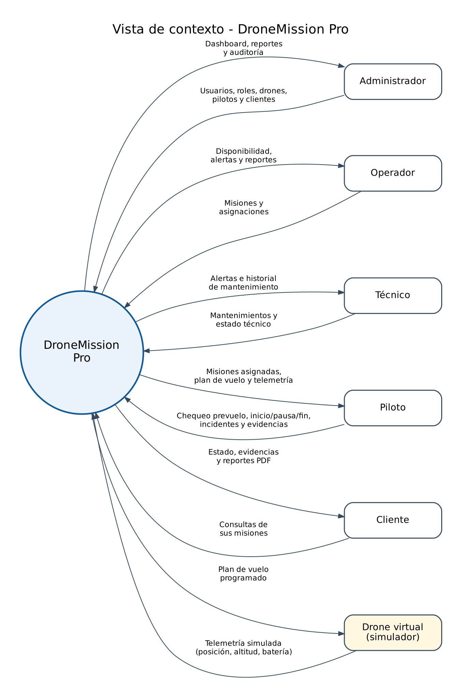
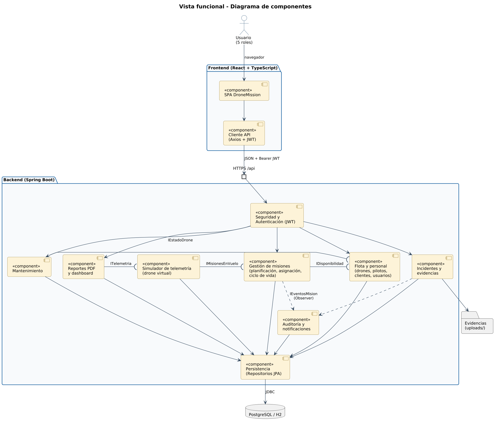
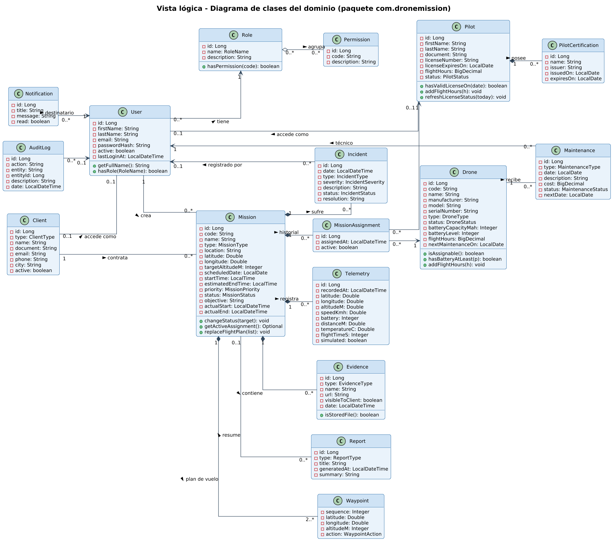
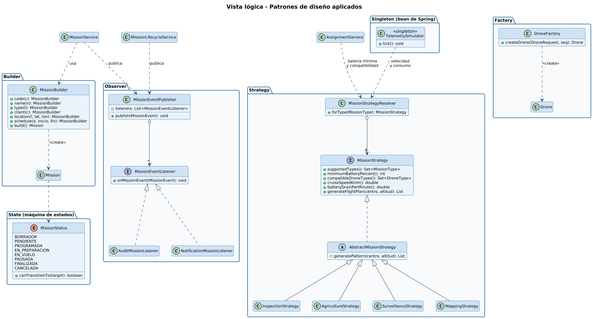
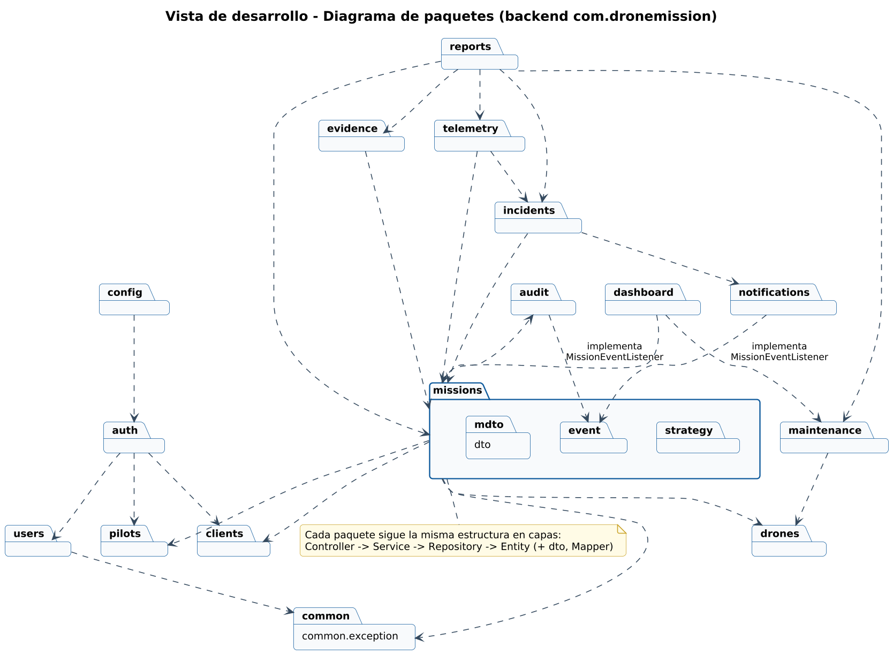
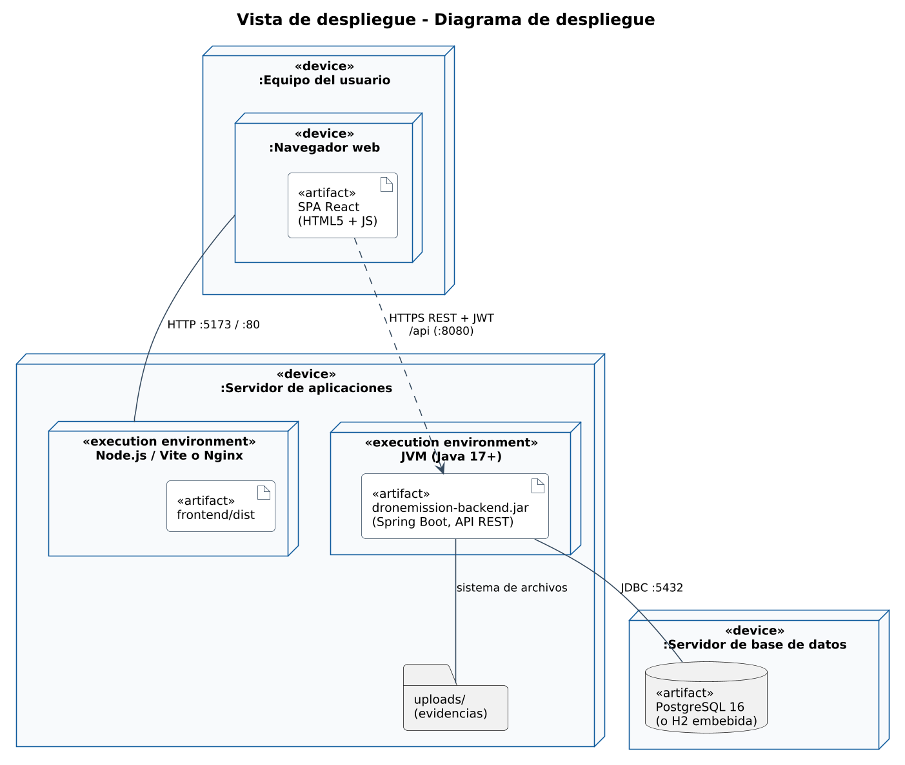
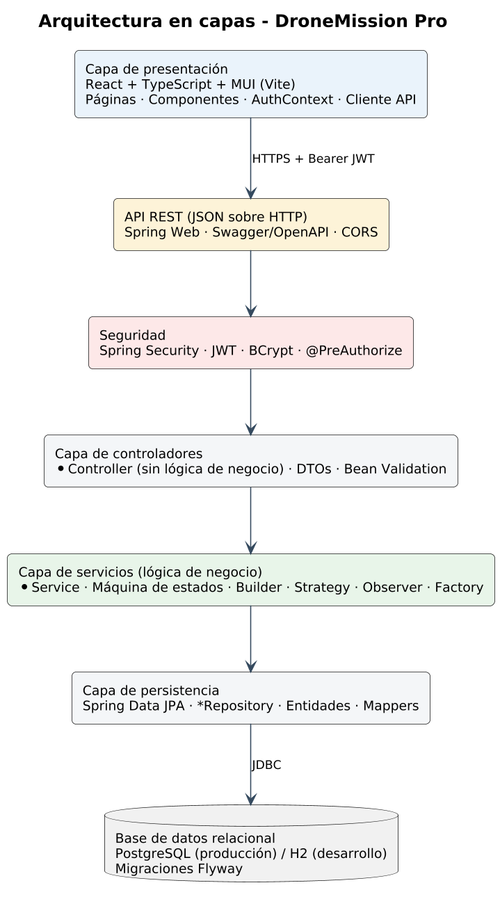

# Arquitectura de DroneMission Pro

El sistema se documenta con las **cinco vistas** del modelo de presentación del curso. Cada vista tiene su fuente PlantUML en `docs/diagrams` y su imagen en `docs/diagrams/png`.

| Vista | Pregunta que responde | Diagrama |
|---|---|---|
| **Vista de contexto** | ¿Con quién interactúa el sistema y qué información intercambia? | [vista-contexto](../diagrams/png/context/vista-contexto.png) |
| **Vista funcional** | ¿Qué componentes ofrecen las funciones y cómo se conectan (interfaces)? | [vista-funcional-componentes](../diagrams/png/component/vista-funcional-componentes.png) |
| **Vista lógica** | ¿Qué clases/entidades forman el dominio y cómo se relacionan? | [clases](../diagrams/png/class/vista-logica-clases.png), [patrones](../diagrams/png/class/vista-logica-patrones.png) |
| **Vista de desarrollo** | ¿Cómo está organizado el código en paquetes? | [paquetes](../diagrams/png/package/vista-desarrollo-paquetes.png) |
| **Vista de despliegue** | ¿En qué nodos se ejecuta cada artefacto? | [despliegue](../diagrams/png/deployment/despliegue.png) |

---

## 1. Vista de contexto



DroneMission Pro es el círculo central. Lo rodean cinco actores humanos y el **drone virtual**. Cada flecha es un flujo de información:

- El **administrador** envía catálogos (usuarios, drones, pilotos, clientes) y recibe dashboard, reportes y auditoría.
- El **operador** envía misiones y asignaciones; recibe disponibilidad y alertas.
- El **piloto** envía el chequeo prevuelo, las órdenes de vuelo, incidentes y evidencias; recibe sus misiones, el plan de vuelo y la telemetría.
- El **técnico** registra mantenimientos; recibe alertas.
- El **cliente** consulta; recibe estado, evidencias y reportes PDF.
- El **drone virtual** recibe el *plan de vuelo programado* y devuelve *telemetría simulada*.

## 2. Vista funcional



Componentes principales y sus interfaces (notación UML de *lollipop* / *socket*):

| Componente | Responsabilidad | Interfaz que ofrece / usa |
|---|---|---|
| SPA DroneMission | Pantallas, formularios, mapa y gráficas | usa el Cliente API |
| Seguridad y Autenticación | Login, JWT, filtro y permisos | puerto `HTTPS /api` |
| Gestión de misiones | Crear, programar, asignar, ciclo de vida | usa `IDisponibilidad`; publica `IEventosMision` |
| Flota y personal | Drones, pilotos, clientes, usuarios | ofrece `IDisponibilidad`, `IEstadoDrone` |
| Simulador de telemetría | Drone virtual que recorre el plan | usa `IMisionesEnVuelo`; ofrece `ITelemetria` |
| Mantenimiento | Registra mantenimientos y cambia el estado del drone | usa `IEstadoDrone` |
| Incidentes y evidencias | Registro de eventos y archivos | almacenamiento `uploads/` |
| Reportes y dashboard | PDF e indicadores | usa `ITelemetria` |
| Auditoría y notificaciones | Observadores de los eventos de misión | escucha `IEventosMision` |
| Persistencia | Repositorios JPA | JDBC a PostgreSQL/H2 |

## 3. Vista lógica



Entidades del dominio (cada una corresponde a una tabla, ver [ERD](../diagrams/png/erd/erd.png)):
`User, Role, Permission, Client, Pilot, PilotCertification, Drone, Mission, MissionAssignment, Waypoint, Telemetry, Evidence, Incident, Maintenance, Report, AuditLog, Notification`.

Decisiones importantes:
- `Mission` **no guarda** el drone ni el piloto directamente: se relaciona con `MissionAssignment` (historial; una asignación activa). Así una reasignación no pierde información (normalización).
- `Waypoint` es el **plan de vuelo programado con anticipación**: lo genera la estrategia del tipo de misión.
- La lógica de dominio vive en las entidades cuando es propia de ellas (`Mission.changeStatus`, `Pilot.hasValidLicenseOn`, `Drone.isAssignable`).

Patrones (detalle en [patrones-de-diseno.md](patrones-de-diseno.md)):



## 4. Vista de desarrollo



El backend se organiza **por módulo funcional** (paquete por característica). Dentro de cada paquete se repite la misma estructura en capas:

```
com.dronemission.<módulo>/
├── <Entidad>.java              ← entidad JPA (tabla en español)
├── <Entidad>Repository.java    ← acceso a datos (Spring Data)
├── <Módulo>Service.java        ← reglas de negocio
├── <Módulo>Controller.java     ← endpoints REST (sin lógica)
├── <Entidad>Mapper.java        ← conversión entidad ↔ DTO
└── dto/                        ← objetos de entrada/salida con validaciones
```

El frontend sigue la misma división: `pages/<módulo>`, `api/endpoints.ts`, `components/`, `types/`.

## 5. Vista de despliegue



- **Equipo del usuario:** navegador con la SPA (HTML5 + JS).
- **Servidor de aplicaciones:** Node/Vite (desarrollo) o Nginx (producción) sirve el frontend; la JVM ejecuta `dronemission-backend.jar` en el puerto 8080; carpeta `uploads/` para evidencias.
- **Servidor de base de datos:** PostgreSQL 16 (o H2 embebida en desarrollo, dentro del mismo proceso).

---

## Arquitectura en capas



```
Frontend (React + TypeScript)
        │  HTTPS / JSON + JWT
        ▼
API REST (Spring Web)  →  Seguridad (Spring Security + JWT)
        ▼
Controllers  →  Services (lógica de negocio)  →  Repositories (Spring Data JPA)
        ▼
PostgreSQL / H2  (migraciones Flyway)
```

## Tecnologías

| Capa | Tecnología | Por qué |
|---|---|---|
| Frontend | React 18, TypeScript, Vite, React Router, MUI, Recharts, Axios, Day.js | Estándar de la industria, tipado, componentes profesionales |
| Backend | Java 17, Spring Boot 3.3, Spring Web, Data JPA, Security, Validation | Arquitectura en capas clara y muy usada en la academia |
| Seguridad | JWT (jjwt 0.12), BCrypt | Autenticación sin estado y contraseñas cifradas |
| BD | PostgreSQL 16 / H2 (modo PostgreSQL), Flyway | Relacional; H2 permite ejecutar sin instalar nada |
| Documentación API | springdoc-openapi (Swagger UI) | Endpoints probables desde el navegador |
| Reportes | OpenPDF | Generación de PDF en el servidor |
| Pruebas | JUnit 5, Mockito, Spring Boot Test, MockMvc, Vitest | Unitarias e integración |
| Diagramas | PlantUML | Diagramas como código, versionados |

## Comunicación frontend ↔ backend

1. El usuario inicia sesión (`POST /api/auth/login`) y recibe un JWT.
2. Axios agrega `Authorization: Bearer <token>` a cada petición.
3. El filtro JWT valida el token y carga los permisos del rol desde la BD.
4. `@PreAuthorize` permite o niega el endpoint (403).
5. El servicio aplica las reglas; los errores vuelven en el formato `ApiError` y el frontend muestra el `message`.
6. Las respuestas de misión incluyen `availableActions`: el frontend muestra solo los botones que el backend permite (no se duplica la lógica).
7. La telemetría se consulta cada 2 s (polling) mientras la misión está en vuelo.
