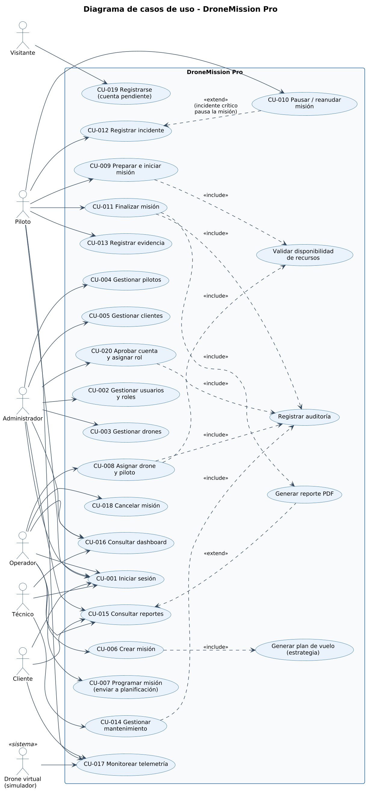

# Casos de uso

Diagrama: [`docs/diagrams/use-case/casos-de-uso.puml`](../diagrams/use-case/casos-de-uso.puml) · 

| Código | Caso de uso | Actor principal |
|---|---|---|
| CU-001 | [Iniciar sesión](CU-001-iniciar-sesion.md) | Todos los usuarios |
| CU-019 | [Registrarse](CU-019-registrarse.md) | Visitante |
| CU-020 | [Aprobar cuenta](CU-020-aprobar-cuenta.md) | Administrador |
| CU-002 | [Gestionar usuarios y roles](CU-002-gestionar-usuarios-y-roles.md) | Administrador |
| CU-003 | [Gestionar drones](CU-003-gestionar-drones.md) | Administrador (consulta: Operador, Técnico) |
| CU-004 | [Gestionar pilotos](CU-004-gestionar-pilotos.md) | Administrador (consulta: Operador) |
| CU-005 | [Gestionar clientes](CU-005-gestionar-clientes.md) | Administrador (consulta: Operador) |
| CU-006 | [Crear misión](CU-006-crear-mision.md) | Operador |
| CU-007 | [Programar misión](CU-007-programar-mision.md) | Operador |
| CU-008 | [Asignar drone y piloto](CU-008-asignar-drone-y-piloto.md) | Operador |
| CU-009 | [Preparar e iniciar misión](CU-009-preparar-e-iniciar-mision.md) | Piloto |
| CU-010 | [Pausar / reanudar misión](CU-010-pausar-reanudar-mision.md) | Piloto |
| CU-011 | [Finalizar misión](CU-011-finalizar-mision.md) | Piloto |
| CU-012 | [Registrar incidente](CU-012-registrar-incidente.md) | Piloto (gestión: Operador) |
| CU-013 | [Registrar evidencia](CU-013-registrar-evidencia.md) | Piloto, Operador |
| CU-014 | [Gestionar mantenimiento](CU-014-gestionar-mantenimiento.md) | Técnico |
| CU-015 | [Consultar reportes](CU-015-consultar-reportes.md) | Administrador, Operador, Cliente |
| CU-016 | [Consultar dashboard](CU-016-consultar-dashboard.md) | Administrador, Operador, Técnico |
| CU-017 | [Monitorear telemetría](CU-017-monitorear-telemetria.md) | Piloto, Operador, Cliente |
| CU-018 | [Cancelar misión](CU-018-cancelar-mision.md) | Operador |
